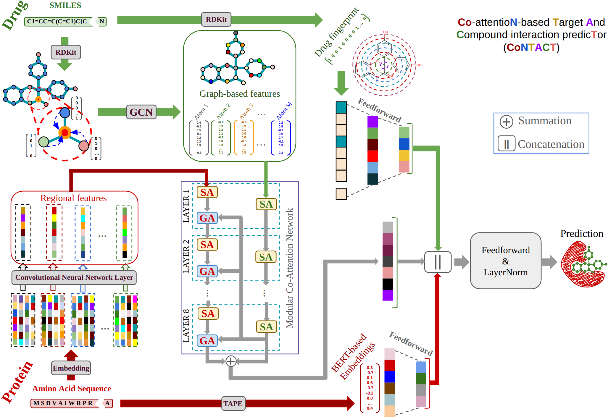

# CoNTACT

## CoNTACT Architecture
CoNTACT encodes amino acid sequences using trainable embeddings and TAPE-BERT trained embeddings and utilizes a GCN and drug fingerprints to capture the atomic features of compounds. It incorporates modular co-attention network (MCAN), which help the model learn how each atom in a compound attends to different parts of a protein. The architecture of CoNTACT is as follows:



## Prerequisite
You must follow these steps before executing the commands:

1. Create a conda environment and activate it:
```
conda create --name lastenv python=3.8
conda activate lastenv
```
Then, install the following packages and libraries:

```
conda install pytorch==1.7.1 torchvision==0.8.2 torchaudio==0.7.2 cudatoolkit=11.0 -c pytorch
conda install -c dglteam dgl-cuda11.0==0.7.1
pip install rdkit-pypi
pip install dgllife==0.2.8
pip install -U scikit-learn
pip install yacs
pip install prettytable
```
If you are interested in extracting TAPE-BERT embeddings for particular amino acid sequences, install the following package:
```
pip install tape_proteins
```


## Datasets
The datasets must be in CSV format and contain at least three columns with the headers: "Canonical SMILES", "Sequence", and "bind", separated by commas. Each dataset should include training, validation, and test sets. For each run, create a dedicated folder within the datasets/ directory and place the corresponding files in that folder.

## Execute on binary data
To train CoNTACT from scratch using a binary dataset, use the following command:
```
python main.py --data <data-dir> --train <training-file-without.csv> --test <test-file-without.csv> --val <validation-file-without.csv>
```
To fine-tune CoNTACT, in addition to the above arguments, you need to specify a pre-trained model using the --load_model argument and set the --mode argument to "fine-tune". Please note that by default, the --mode argument is set to "scratch", which trains the model from scratch.
```
python main.py --data <data-dir> --train <training-file-without.csv> --test <test-file-without.csv> --val <validation-file-without.csv> --load_model <existing-pretrained-binary-model> --mode fine-tune
```
Please note that the existing pre-trained binary model must be located in the output/result/<data-dir> folder.

If you are interested in using a pre-trained CoNTACT model based on public datasets containing compounds with up to 60 atoms and proteins with fewer than 1,400 amino acids, put the 'CoNTACT_Binary_LAID_Accurate_60atoms.pth' file, which is located in the output/result/toy_example folder, in the output/result/<data-dir> folder and execute the previous command.

## Execute on regression-based data
To train CoNTACT on a regression-based dataset (e.g., Thermal Shift Assay), you must first ensure that a binary pre-trained model is located in the output/result/<data-dir> folder. Then, execute the following command:
```
python main_regression.py --data <data-dir> --train <training-file-without.csv> --test <test-file-without.csv> --val <validation-file-without.csv> --load_bin_model <existing-pretrained-binary-model> 
```
If you have already pre-trained CoNTACT on a regression-based dataset, you must first ensure that a binary pre-trained model and a regression-based model are located in the output/result/<data-dir> folder. Then, execute the following command:
```
python main_regression.py --data <data-dir> --train <training-file-without.csv> --test <test-file-without.csv> --val <validation-file-without.csv> --load_bin_model <existing-pretrained-binary-model> --load_model <existing-pretrained-regression-based-model>
```
